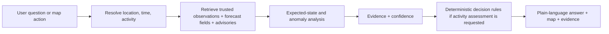

# Nautiq — Project Overview

> **Purpose:** Define exactly what Nautiq is, who it is for, what it does, and what it does not do.\
> **Product name:** Nautiq\
> **Initial operating geography:** India and the Northern Indian Ocean, with geography kept configurable so the platform can expand globally.  
> **Read this first.**

---

## 1. Document set

The project is deliberately split into six documents so each topic has one owner and information is not repeated.

The six documents define the target product. Execution contracts in `08-Execution-Contracts.md`, the failure register in `09-Edge-Case-Register.md`, and measured Phase 0 evidence in `10-Phase-0-Delivery.md` make the target actionable. `07-Phase-1-Delivery.md` records the actual platform; `11-Phase-2-Delivery.md` records the delivered Argo slice. `12-Phase-3-Delivery.md` records reproducible calculations, QC/freshness monitoring and frozen training snapshots. `13-Phase-4-Delivery.md` records the train-only harmonic reference, profile differences and measured regional/depth evaluation. `14-Phase-5-Delivery.md` records residual LightGBM/HGBR comparisons, immutable MLflow/model release pins and revision-safe gRPC inference with climatology fallback. A design statement is not an implementation or validation claim.

| File | Owns |
|---|---|
| `01-Nautiq-Project-Overview.md` | Product definition, users, goals, boundaries, product logic |
| `02-Nautiq-Data-Platform.md` | Data sources, ingestion, schemas, QC, storage, freshness, lineage |
| `03-Nautiq-ML-Design.md` | Climatology, ML models, uncertainty, anomaly detection, validation |
| `04-Nautiq-System-Architecture.md` | Services, languages, communication, concurrency, reliability, deployment |
| `05-Nautiq-Product-Surfaces.md` | UI, user flows, APIs, alerts, natural-language interface |
| `06-Nautiq-Implementation-Blueprint.md` | Repository layout, build order, testing, CI/CD, delivery plan |
| `07-Phase-1-Delivery.md` | Platform delivery and dated verification |
| `08-Execution-Contracts.md` | Versioned execution policies and cross-service contracts |
| `09-Edge-Case-Register.md` | Failure scenarios, expected behavior and verification ownership |
| `10-Phase-0-Delivery.md` | Feasibility tooling, measured source/science evidence and outstanding gates |
| `11-Phase-2-Delivery.md` | Argo ingestion, canonical profiles, API/explorer and measured recovery checks |
| `12-Phase-3-Delivery.md` | Revision-safe calculations, QC/source monitoring, frozen fixtures and pinned training snapshots |
| `13-Phase-4-Delivery.md` | Standard depths, train-only seasonal climatology, profile comparisons and held-out evidence |
| `14-Phase-5-Delivery.md` | Shared residual features, grouped audits, native LightGBM/HGBR comparisons, MLflow registry and pinned expected-mean inference |
| `15-Phase-6-Delivery.md` | Predictive quantile/CQR intervals, calibration support and fixed-reference coverage evidence |
| `16-Phase-7-Delivery.md` | Complete-case residual magnitude, correlated distance, weighted PCA and historical ranks |
| `17-Phase-8-Delivery.md` | Real SST/wave/weather/current adapters, immutable Zarr releases, field sampling and raster explorer |
| `18-Phase-9-Delivery.md` | Fixed daily SST baseline, persistent regional candidates and separate sparse profile groups |
| `19-Phase-10-Delivery.md` | Immutable official CAP bulletins, authority coverage and revision handling |
| `20-Phase-11-Delivery.md` | Timed diagnostic trips, private frozen receipts and exact replay |
| `21-Phase-12-Delivery.md` | Public product views, authenticated owned state, research queries and private exports |
| `22-Phase-13-Delivery.md` | Evidence-based alert lifecycle, durable in-app/email delivery and recipient verification |

If a detail belongs to another document, this file references it instead of duplicating it.

---

## 2. What Nautiq is

Nautiq is an **ocean and marine-condition intelligence platform**.

It combines:

- historical ocean observations;
- near-real-time observations;
- satellite and gridded ocean products;
- marine weather, wave and current forecasts;
- official marine advisories;
- machine-learning models that estimate the normal/expected ocean state;
- anomaly and event detection;
- deterministic fishing/trip condition assessment;
- maps, alerts, reports and natural-language search.

The product goal is not to show raw scientific numbers. The goal is to answer:

> **What is happening here, is it unusual, what is likely to matter for my activity, and what evidence supports the answer?**

---

## 3. Core questions Nautiq must answer

### 3.1 General ocean questions

- What is the current sea-surface temperature here?
- Is the ocean warmer or cooler than normal for this location and season?
- How has temperature or salinity changed over the last week or month?
- Are there unusual profiles nearby?
- What is happening in the Arabian Sea / Bay of Bengal right now?
- Are currents or waves changing significantly?
- Is there a persistent warm event in this region?

### 3.2 Fishing and marine-trip questions

- Is it a good time to go fishing now?
- Are conditions favorable for a small fishing boat tomorrow morning?
- Is there an official marine warning on my route?
- When is the best conditions window for my trip?
- Will waves or winds get worse before I return?
- Which nearby area currently has calmer conditions?
- What is the worst segment of my planned route?
- Why is Nautiq recommending caution?

### 3.3 Research questions

- Show profiles in a region over a date range.
- Compare observed temperature with the expected climatological/ML value.
- Show residuals by depth.
- Find profiles with the strongest structural anomalies.
- Export QC-passed observations with model predictions and provenance.
- Compare two regions or two time periods.

---

## 4. Who uses it

### 4.1 General users

Need simple answers, maps, freshness and understandable explanations.

They should see:

- current conditions;
- normal vs unusual;
- trend;
- official advisories;
- a plain-language reason for any caution.

### 4.2 Fishers and fishing teams

Need:

- wind;
- waves and swell;
- currents;
- visibility/weather context;
- official advisories;
- trip windows;
- route conditions;
- ocean-state context such as temperature anomalies.

Nautiq **does not predict fish catch**.

### 4.3 Recreational marine users

Examples:

- small-boat users;
- sailors;
- kayakers;
- coastal-trip planners.

Their experience is activity-aware: the same environmental conditions can matter differently for different activities.

### 4.4 Researchers and students

Need:

- exact observations;
- depth profiles;
- QC flags;
- model versions;
- residuals;
- confidence/calibration information;
- reproducible exports;
- source provenance.

### 4.5 Coastal agencies and domain professionals

Need a trustworthy overview of:

- source freshness;
- regional anomalies;
- official advisory overlays;
- data coverage;
- explainable model output.

---

## 5. The central product flow



There are two distinct reasoning paths.

### Scientific path

```text
observations
→ expected normal state
→ residuals
→ profile/event detection
→ evidence
```

### Activity-decision path

```text
forecast fields
+ official advisories
+ freshness/completeness
+ user activity thresholds
→ deterministic rules
→ favorable / caution / unfavorable / insufficient data
```

The ML output can appear as **ocean context**, but it must not control a safety verdict.

---

## 6. Product principles

### 6.1 Evidence first

Every displayed insight must be traceable to:

- data source;
- observation or forecast time;
- QC state;
- transformation;
- model/version if ML was used;
- calculation time.

### 6.2 “Unknown” is a valid answer

If a critical source is stale, unavailable or outside its forecast horizon, Nautiq must say so.

It must not convert missing data into reassurance.

### 6.3 Official advisories dominate

An official advisory is visually and logically separate from Nautiq-derived signals.

If an official warning exists, Nautiq must surface it prominently.

### 6.4 ML is used where it adds value

ML is used for:

- estimating the expected/normal ocean state;
- measuring deviations from that state;
- helping detect unusual water-column structure.

ML is **not** used to:

- issue official warnings;
- generate weather forecasts;
- make a black-box safety decision;
- predict fish catch.

### 6.5 Near-real-time must be labeled honestly

Each result should expose:

- observed/forecast valid time;
- time received by Nautiq;
- age;
- source mode: historical, near-real-time, forecast, reanalysis, official advisory.

---

## 7. Marine activity decision support

The decision-support engine is deterministic and explainable.

### Inputs

Depending on availability:

- official marine advisories;
- wind and gusts;
- significant wave height;
- wave period;
- swell direction;
- surface current;
- visibility;
- precipitation;
- thunderstorm probability;
- route and time window;
- activity type;
- optional user thresholds.

### Verdict states

| State | Meaning |
|---|---|
| `official_warning` | A relevant official advisory is active |
| `unfavorable` | One or more critical environmental limits are exceeded |
| `caution` | Conditions are near limits or are expected to deteriorate |
| `insufficient_data` | Required data is missing, stale or outside the forecast horizon |
| `favorable` | Required inputs are present/fresh and remain inside configured limits |

Recommended wording:

- “Conditions appear favorable based on the available data.”
- “Conditions call for caution.”
- “Conditions are unfavorable for this activity.”
- “Available data is insufficient to make a reliable assessment.”
- “An official marine warning is active; check the issuing authority.”

Avoid:

- “It is safe.”
- “You should definitely go.”
- “Fishing will be good.”
- “There is no risk.”

---

## 8. What Nautiq does not do

| Non-goal | Reason |
|---|---|
| Issue cyclone, tsunami, high-wave or other official warnings | Nautiq relays authoritative advisories; it does not replace issuing agencies |
| Run its own full weather/ocean numerical forecast model | Forecast fields come from external forecast centres |
| Provide navigation-grade safety-of-life guidance | It is decision support, not a regulated navigation system |
| Predict catch/abundance | Environmental suitability is not fish availability |
| Treat an anomaly as proof of a named event | Event definitions require their own validated detector |
| Use a chatbot as the scientific engine | Language only translates intent to validated queries and explains trusted results |

---

## 9. What makes the product useful

Nautiq is valuable because it joins information that is normally fragmented:

```text
observations
+ satellite fields
+ forecast fields
+ official advisories
+ climatology
+ ML residuals
+ anomaly/event detectors
+ activity rules
= one explainable answer
```

The differentiator is **not “AI”**.

The differentiator is:

> **Turning fragmented ocean and marine-condition data into understandable, evidence-backed decisions.**

---

## 10. Definition of a complete product

The product is ready only when all of these work together.

### Data

- multiple sources ingest automatically;
- data is normalized and QC-controlled;
- stale/revised data is handled;
- source provenance is preserved.

### Intelligence

- normal/expected state is modeled and validated;
- uncertainty is calibrated;
- profile anomalies are interpretable;
- regional events are detected separately;
- model failure degrades gracefully.

### Product

- map;
- location/region pages;
- fishing/trip assessment;
- route assessment;
- watchlists;
- alerts;
- research explorer;
- natural-language query interface;
- evidence panels.

### Trust

- official advisories are clearly separated;
- safety wording is controlled;
- data freshness is visible;
- calculation provenance is reproducible;
- models publish validation limits.

### Engineering

- tests;
- monitoring;
- backups;
- incident controls;
- CI/CD;
- secure authentication;
- staged production deployment.

Implementation order and acceptance gates are defined in `06-Nautiq-Implementation-Blueprint.md`.

## 11. Release boundaries and measurement meaning

The first deliverable is an **observation explorer**: validated Argo profiles, QC, depth charts and exact provenance. It does not require a model, gridded forecasts or an advisory feed. A science preview adds validated historical comparisons. Trip assessment is a separate release requiring operational forecasts, advisory completeness and approved decision policy. Alerts and language are later releases on proven APIs.

“Current” always names a source and valid time. A recent ingestion timestamp cannot make an old measurement current. An Argo value at 10m is not automatically SST, and a nearby float is not a measurement at the user's coordinate. Present actual instrument position, depth, age and query distance; decline a comparison outside the validated matching policy.

The expected interval describes variability of observations around historical normal. It is not a confidence interval for the climatological mean, a forecast interval, or a probability that a trip is safe. Profile percentiles are conditional on comparison group and coverage; 97th percentile is not 97% certainty of an event.

Deployment scope is explicit: local runtime, feasibility pilot, internal science preview, or public product. Public trip release remains blocked while authoritative advisory state is unknown. No completed roadmap phase implicitly unlocks another capability.

## 12. Product acceptance under failure

- Source outage: retain clearly timestamped observations; mark affected layers unavailable and avoid mixed fresh/stale confidence.
- Model outage: climatology is a separately versioned fallback, not a silent substitute retaining the ML label.
- No observations: return an empty, explained state; never a fabricated profile or zero value.
- Known warning and incomplete forecasts: show the warning and missing inputs together; no green fallback.
- Offline client: cached values retain their original expiry; trip verdicts must be reevaluated online before a new departure window.
- Revised evidence: preserve historical calculations, identify supersession and offer a new calculation; do not rewrite what an earlier alert said.

- [Predictive interval delivery, calibration, monitoring and verification](15-Phase-6-Delivery.md)
