# Nautiuq — Data Platform

> **Owns:** Data sources, ingestion, normalization, QC, canonical schemas, storage, freshness, revisions, lineage and training datasets.  
> **Does not own:** ML algorithms (`03`), service deployment (`04`) or UI/API behavior (`05`).

---

## 1. Data model: three different kinds of information

Nautiuq must not treat every source as the same shape.

### 1.1 In-situ observations

Sparse measurements from instruments such as:

- Argo floats;
- moored buoys;
- drifting buoys;
- selected station feeds.

Typical variables:

- temperature;
- salinity;
- pressure/depth;
- oxygen;
- chlorophyll;
- pH;
- nitrate.

These are stored as discrete observations/profiles.

### 1.2 Gridded fields

Dense spatial arrays from satellite, analysis and forecast products:

- sea-surface temperature;
- wind;
- waves/swell;
- currents;
- visibility/weather fields;
- precipitation;
- sea-level or other contextual products.

These should remain as multidimensional field data rather than millions of relational rows.

### 1.3 Official advisories

Official bulletins/polygons are a separate class.

They are never mixed into model output.

Every advisory stores:

- issuing authority;
- issue time;
- valid period;
- geographic geometry;
- severity/category;
- original text/link;
- source version;
- feed-health state.

---

## 2. Source strategy

Use provider adapters so the rest of the platform does not depend on one API.

### 2.1 Argo GDAC

**Role:** authoritative profile source and primary historical training source.

Use for:

- core temperature/salinity profiles;
- real-time/adjusted/delayed modes;
- float metadata;
- profile revisions.

For training labels, prefer delayed-mode QC data.

### 2.2 Argovis

**Role:** convenient API access and cross-check/fallback for Argo-style profile queries.

It is not a substitute for preserving original Argo provenance.

### 2.3 INCOIS

**Role:** India/Northern Indian Ocean observations, forecast/advisory context and selected buoy/ocean products where programmatic access and terms allow.

Each dataset must be integrated separately; “INCOIS” is not one homogeneous API.

### 2.4 Copernicus Marine

**Role:** gridded ocean analysis/forecast/reanalysis products such as:

- currents;
- temperature/salinity fields;
- waves where applicable;
- regional/global ocean context.

### 2.5 NASA / GHRSST-class SST products

**Role:** broad surface-temperature coverage and SST anomaly/event analysis.

### 2.6 NOAA / ERDDAP-compatible sources

**Role:** supplementary buoy/station observations and standardized scientific endpoints.

### 2.7 Weather and wave forecast providers

**Role:** fishing/trip assessment.

These forecasts are inputs to Nautiuq's rule engine; Nautiuq does not claim to have generated them.

---

## 3. Trust and provenance

Every source has metadata:

```text
source_id
provider
dataset_name
dataset_version
authority_class
license
attribution
redistribution_rules
expected_update_cadence
upstream_url
```

Suggested trust classes:

| Class | Meaning |
|---|---|
| A | Authoritative official or primary scientific source |
| B | Maintained scientific derived product |
| C | Trusted convenience/API representation of an authoritative source |
| D | Experimental/supplementary source |

Trust class is used for provenance and duplicate resolution, not as a simplistic “good/bad” score.

---

## 4. Ingestion pipeline

```mermaid
flowchart LR
    SRC[Provider]
    SRC --> DISC[Discover changed objects/records]
    DISC --> FETCH[Fetch with bounded concurrency]
    FETCH --> RAW[Immutable raw storage]
    RAW --> EVT[raw.received event]
    EVT --> PARSE[Parse + schema validation]
    PARSE --> UNIT[Normalize units]
    UNIT --> QC[Source QC + Nautiuq QC]
    QC --> DEDUP[Canonicalize + deduplicate]
    DEDUP --> STORE[Operational DB + Parquet/Zarr]
    STORE --> READY[observation/profile/field ready]
```



Important properties:

- ingestion is incremental;
- raw bytes are preserved;
- consumers are idempotent;
- each rejection has a reason;
- one provider failure does not block others.

---

## 5. Raw storage

Use S3-compatible object storage.

Raw data is immutable.

Example layout:

```text
raw/{provider}/{dataset}/{yyyy}/{mm}/{dd}/{filename}__{sha256}.{ext}
```

Store:

- original file;
- source URI;
- fetch time;
- SHA-256;
- HTTP/provider metadata;
- upstream version/update timestamp.

If an upstream file changes, write a new object instead of overwriting the old one.

This makes later scientific reconstruction possible.

---

## 6. Canonical observation schema

A normalized observation should contain enough information to answer:

> What was measured, where, when, by what, under what quality state, and from which raw source?

Core shape:

```text
observation_id
canonical_key

source_id
source_record_id
platform_id
profile_id

observed_at
received_at

latitude
longitude
depth_m
pressure_dbar

temperature_c
practical_salinity
oxygen
chlorophyll
ph
nitrate

data_mode
quality_state
raw_quality_flags
qc_version

revision
superseded_by

raw_artifact_id
ingestion_run_id
created_at
```

Rules:

- missing means null, never zero;
- canonical units are fixed;
- source-native values/flags remain recoverable;
- `practical_salinity` is stored as PSS-78 practical salinity; UI may label it in familiar language.

---

## 7. Profile identity

For Argo-like sources, prefer source-native identity:

```text
source_family
platform_number
cycle_number
profile_direction
native_profile_discriminator
```

Stable identity excludes revision and observed coordinates/time. Store revisions separately using raw SHA-256 plus source update metadata. Core files with secondary profiles need a source-native discriminator; Phase 0 rejects multiprofile files until that policy is implemented. Revisions must not create new training examples for the same stable profile.

A profile owns many depth-level observations.

Do not identify scientific profiles only with rounded latitude/longitude.

---

## 8. Deduplication

The same underlying profile can appear through more than one endpoint/provider.

Deduplicate at two levels.

### 8.1 Profile level

Prefer:

```text
platform + cycle/profile id + direction + observation time
```

### 8.2 Level/record level

Within a profile:

```text
profile identity + depth/pressure level + variable group
```

If native identity is unavailable, use tolerant matching:

- platform/station;
- close timestamp;
- close coordinate;
- close depth.

Keep every source reference in a link table even when one canonical record is selected.

Canonical selection considers:

1. primary authority;
2. data mode/QC;
3. revision recency;
4. completeness.

---

## 9. Quality-control state machine

```text
RAW
→ SCHEMA_VALID
→ SOURCE_QC_EVALUATED
→ UNIT_NORMALIZED
→ CANONICAL
→ SCIENCE_READY
→ FEATURE_READY
```

Possible side states:

```text
REJECTED
DUPLICATE_LINKED
SUPERSEDED
QUARANTINED
```

Nothing is silently discarded.

A rejection stores:

```text
record/source
rule_id
reason_code
qc_version
timestamp
```

---

## 10. Argo-specific handling

For a scientific profile:

1. read pressure, temperature, salinity and their QC fields;
2. inspect `DATA_MODE`;
3. prefer valid adjusted values where required by the QC policy;
4. keep original mode and flags;
5. convert pressure/depth consistently;
6. build profile identity;
7. retain revision history.

A real-time profile can later become delayed-mode.

That is a revision, not a duplicate.

When a profile revision arrives:

```text
new revision
→ old revision marked superseded
→ dependent predictions marked stale
→ affected aggregates recomputed
→ historical training snapshots remain immutable
```

---

## 11. Gridded data storage

Do not put entire forecast/satellite fields into PostgreSQL row-by-row.

Use Zarr on object storage.

Conceptual layout:

```text
fields/{provider}/{product}/{cycle_or_version}/{variable}.zarr/
```

A field catalog in PostgreSQL stores:

```text
product
variable
cycle
valid_time_start
valid_time_end
spatial_extent
resolution
units
zarr_uri
source_version
ingested_at
```

The Field Service reads Zarr for:

- point sampling;
- route sampling;
- polygon summaries;
- raster tiles.

---

## 12. Operational database

Use PostgreSQL with:

- PostGIS for spatial queries;
- TimescaleDB for time-series observations/aggregates.

PostgreSQL is the operational source for:

- canonical observations;
- profiles;
- source catalog;
- predictions/anomaly results;
- advisories;
- watchlists/routes/alerts;
- calculation provenance.

Object storage is the source for:

- raw artifacts;
- Parquet lake;
- Zarr fields;
- frozen training snapshots;
- model/export artifacts.

Redis is cache only.

---

## 13. Parquet lake

Normalized data should also be written to Parquet for:

- ML training;
- offline analysis;
- large exports;
- reproducible dataset snapshots.

Example:

```text
lake/observations/
  schema=v1/
  year=2026/
  month=10/
  variable_group=core/
  region_cell=.../
  part-....parquet
```

Use:

- ZSTD compression;
- stable schema versions;
- partitioning by time and broad region/variable group.

Avoid over-partitioning by individual float or tiny geographic cells.

---

## 14. Historical ML dataset construction

Training must not query live APIs repeatedly.

Build frozen snapshots:

```text
raw history
→ canonical QC data
→ standard depth grid
→ static geography features
→ split assignments
→ immutable training snapshot
```

Each training dataset version records:

```text
dataset_version
input partitions
baseline period
QC version
feature-schema version
code commit
row/profile counts
spatial coverage summary
temporal coverage summary
```

Primary labels:

- delayed-mode Argo temperature;
- delayed-mode Argo salinity.

Nearshore/surface products may use separate satellite-based datasets because open-ocean Argo coverage is not sufficient near many coasts.

---

## 15. Standard depth representation

Profiles have irregular sampling, but profile-shape methods need comparable depth coordinates.

Create a documented standard grid, for example:

```text
0, 5, 10, 20, 30, 50, 75, 100,
150, 200, 300, 400, 500, 750,
1000, 1500, 2000 m
```

Rules:

- interpolate only through acceptable gaps;
- never extrapolate below/above sampled coverage;
- keep original raw levels;
- store coverage masks;
- feature code must know which depth bands are missing.

The exact grid is calibrated after studying real data coverage.

The Phase 0 grid is pinned in `packages/source-catalog/phase0.json` (10–2000m; no invented 0m value), with a maximum 250m bracketing gap. It is an exploratory policy, not a validated production interpolation choice. A grid/policy change creates a new dataset and QC/method version.

---

## 16. Freshness

Every product exposes two different times:

```text
valid/observed time
ingestion time
```

Source health tracks:

```text
expected cadence
last successful fetch
newest valid time
ingestion lag
parse/QC failure count
```

Example status:

```text
Argo GDAC     healthy     newest profile 9 h old
Wave forecast healthy     newest cycle 1 h old
Advisory feed degraded    no successful update for 45 min
```

If advisory status is unknown, the trip engine must not return a favorable verdict.

---

## 17. Late and revised data

Two horizons matter.

### Late arrival

A record is valid for a past time but arrives later than normal.

Action:

- insert normally;
- refresh affected recent aggregates.

### Revision

A provider replaces/improves a previously ingested scientific record.

Action:

- preserve old revision;
- mark supersession;
- recalculate dependent results;
- do not rewrite frozen historical training snapshots.

This distinction prevents silent changes to reproducible results.

---

## 18. Data-source failure rules

| Failure | Action |
|---|---|
| timeout / 5xx | exponential backoff + jitter |
| 429 | obey `Retry-After`, reduce concurrency |
| auth failure | stop blind retries, mark source unhealthy |
| corrupted file | quarantine raw object |
| schema drift | stop only that dataset, preserve other pipelines |
| suspicious empty feed | record and alert |
| repeated failure | circuit breaker |

Provider-specific rate limits are mandatory.

---

## 19. Data licensing and attribution

Before integrating a dataset, record:

- allowed access method;
- attribution;
- display rights;
- redistribution/export rights;
- cache/storage restrictions;
- retention restrictions.

Nautiuq must be able to block export of a source even if it is allowed to display derived information.

Licensing is a data-platform concern, not a UI afterthought.

---

## 20. Data acceptance checklist

A new source is production-ready only when:

- access is stable enough for automation;
- license/attribution has been reviewed;
- schema fixture exists;
- units are explicitly mapped;
- QC rules are documented;
- source identity/deduplication is defined;
- freshness expectation is configured;
- failure handling exists;
- provenance survives normalization;
- overlap with existing sources is tested;
- at least one historical fixture and one malformed fixture are in CI.

## 21. Concrete Phase 0 QC policy

Version `argo-phase0-D1-v1` is implemented in `ml/nautiuq_ml/phase0/argo.py`. Use core delayed-mode profiles only; `DATA_MODE=D`, position/time QC 1, adjusted PRES/TEMP/PSAL with their own QC 1. Require declared units, finite values, configured domain/baseline and valid platform/cycle/direction. Reject a missing or unsupported pressure representation. Missing/bad salinity may leave temperature usable; QC is per parameter, not a blanket row flag. Missing metadata or unsupported multiprofile files are recorded rejections.

Use TEOS-10 `gsw.z_from_p(pressure, latitude)` for pressure-to-depth; practical salinity remains PSS-78 and is never silently relabelled absolute salinity. Fill values, masked values and NaN remain missing. Exploratory gross bounds are temperature −3..45°C, salinity 0..42, pressure 0..12000dbar; passing these bounds is not proof of scientific validity. No averaging of conflicting repeated depth levels, no vertical extrapolation and no interpolation across an excessive valid-value gap. Retain raw bytes even when parsing rejects the profile.

Near-real-time display will need a separate reviewed QC matrix for R/A/D, raw/adjusted fields, adjustment errors, position/time flags, and per-parameter modes in BGC files. The strict training policy must not be relaxed to make a live feed look complete. Synthetic malformed/QC fixtures are tests, not feasibility data.

## 22. Transaction, revision and storage rules

1. Download into a temporary bounded object; validate length and checksum; publish immutable content-addressed bytes.
2. Register raw artifact and discovery progress in a database transaction that also inserts an outbox event. A cursor advances only through durably recorded objects or explicit quarantine; overlapping timestamp windows and stable tie-breakers prevent missed late records.
3. A normalizer writes canonical revision and inbox receipt plus ready/revised outbox event in one DB transaction. Acknowledge transport only after commit. Parquet/Zarr are staged then manifested separately; `science_ready` requires the object manifest and checksum. A DB row alone cannot claim a complete lake write.
4. Reconcile orphan raw objects, missing manifests and unsent outbox rows. External stores and SQL do not share a transaction; failure must converge through replay, not assumed atomicity.
5. Select current revisions with source policy and monotonic source version, not arrival order. Preserve conflicting references. Predictions/cache keys include revision digest; compare expected revision when writing results so late work cannot overwrite a newer prediction.

A unique stable profile plus immutable revisions is separate from time-series levels. Partition/hypertable design must respect Timescale unique-index requirements; do not assume a global unique profile key alone is enforceable on time-partitioned observations. Index geometry, valid time and current revision queries before scaling. Apply retention only after source license and reproducibility requirements are reconciled.

## 23. Field and advisory edge policies

- Validate CRS, longitude convention, latitude order, calendar, dimension order, units, missing mask, fill/scaling, cycle and lead time before normalizing a field. Handle curvilinear grids explicitly; do not treat every grid as regular lat/lon.
- Store vectors/directions with documented “from/to” and true-north convention. Interpolate vector components, not degrees across 359°/1°. Wave period means must identify their physical definition.
- Land/masked coastal cells remain unavailable. No nearest-cell sampling across land or outside a reviewed distance limit. Record sampled coordinates, interpolation method and spatial resolution.
- Forecast cycle and valid time are separate. No future window outside horizon; no hidden mix of initialization cycles. Reanalysis is not live truth. Preliminary/final SST revisions remain distinct.
- OISST is a blended SST analysis that incorporates in-situ observations. Do not call it independent satellite validation of Argo; verify independence before combining sources into confidence.
- Advisory health requires a verified machine-readable feed, issuer, covered geography/types, complete fetch, heartbeat expectation, valid/cancel/update semantics and redistribution rights. HTTP 200 or an empty webpage cannot establish `known_none`.
- NDMA SACHET provides a public India CAP RSS candidate and an agency guide for individual CAP XML. The guide requires ETag storage and conditional requests after the first fetch; 304 reuses preserved XML and is not a new bulletin. The Phase 0 probe checks the RSS index only, not marine completeness or CAP validity/geometry. [Official integration guide](https://sachet.ndma.gov.in/docs/Integration_Guide_For_Agencies.pdf).
- Advisory geometry can be a polygon, region identifier or uncertain coastal text. Unresolved geometry remains potentially relevant; it cannot be silently dropped. Preserve cancellations and superseded bulletins, with late messages ordered by issuer version.

## 24. Source feasibility versus operational readiness

`packages/source-catalog/phase0.json` pins sample products, endpoints, limits, attribution and unresolved approvals. The probe proves bounded sample access and schema compatibility; it cannot establish long-term cadence or uptime in one fetch. Record availability counts separately from QC-passed training counts. Credentials, scraped page content and transport error bodies must not enter public reports. Full provenance belongs in restricted artifacts; public evidence exposes reviewed source identifiers and links.


## 24. Implemented reproducibility layer

`12-Phase-3-Delivery.md` records the local schema-4 implementation: grouped QC rejection audit, source metadata and separate provider/local freshness, deterministic raw replay, calculation manifests, revision-safe summary recomputation and frozen original-level Parquet snapshots. Existing immutable canonical revisions and source links are preserved. The snapshot builder selects historical revisions as of an explicit UTC time and pins raw/canonical/Parquet digests, strict D/QC1 label policy and chronological split assignments. Later revisions invalidate live summaries, while stored snapshots remain frozen. This does not establish source coverage or scientific production approval.

## Implemented standard-depth representation

[Historical-reference delivery](13-Phase-4-Delivery.md) records the separate schema-5 climatology artifacts. A verified frozen original-level snapshot produces `argo-standard-grid-v1`: 15 depths from 10 to 2,000 m, nullable values and independent per-variable coverage/method metadata. Interpolation uses adjacent native levels with ≤250 m brackets; missing/rejected measurements, nonadjacent native indices and out-of-range targets remain missing. The original snapshot and canonical observations remain immutable and separately available. Model/grid/evaluation/calculation artifacts have immutable hashes; selecting a reference queues durable profile/revision/reference jobs. No new provider acquisition or automatic training is needed to compare existing observations.
