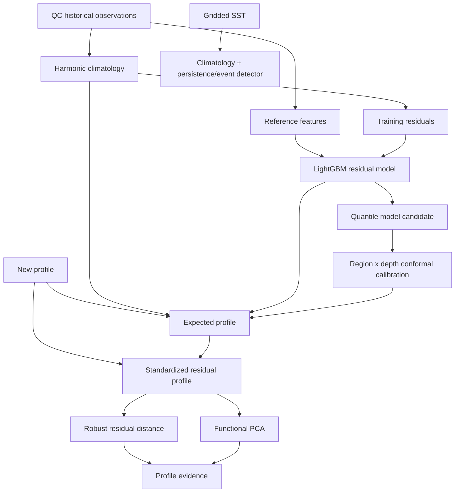

# Nautiuq — Machine Learning and Scientific Detection Design

> **Owns:** Definition of “expected”, climatology, ML models, uncertainty, profile anomaly detection, event detection, validation, explainability and model monitoring.  
> **Canonical design after reviewing the newer ML suggestions:**  
> **harmonic climatology + LightGBM residual model + conformal calibration + residual-profile scoring + functional PCA.**  
> HGBR, Z-score and Isolation Forest are retained as comparison baselines, not the primary production design.

---

## 1. What the ML layer must answer

Nautiuq has three scientific questions.

### Q1 — Expected state

> What temperature or salinity is normal for this place, depth and time of year?

### Q2 — Unusual profile

> Does this whole water-column profile deviate from the expected vertical structure?

### Q3 — Regional event

> Is an anomaly persistent and spatially coherent enough to count as a regional event rather than one strange profile?

These are separate problems and should not be forced into one model.

---

## 2. What “expected” means

The production reference state must represent **normal climatological conditions**, not today's state.

Reference inputs may include:

```text
latitude
longitude
depth
day-of-year harmonics
static bathymetry
distance to coast
region/ocean-basin information
```

Do **not** feed these into the reference model:

```text
today's satellite SST
today's currents
today's waves
today's wind
sea-level anomaly
current climate-mode index
platform ID
profile ID
```

Why?

If today's SST is used to predict “normal SST”, a real warm anomaly is partly copied into the prediction. The residual shrinks and the anomaly becomes harder to detect.

Current-state variables can be used in a separately named **nowcast/interpolation model**, but not in the anomaly reference model.

---

## 3. Baseline first: harmonic climatology

The first layer is not ML.

Fit a smooth climatological expectation by:

```text
geographic cell / region
× depth
× seasonal phase
```

Instead of only 12 independent monthly means, use harmonic seasonal terms so the annual cycle is smooth.

Conceptually:

```text
climatology(location, depth, day_of_year)
```

Outputs:

```text
climatological mean
climatological spread
sample count
coverage quality
```

Benefits:

- captures the large vertical temperature/salinity structure;
- handles seasonality explicitly;
- is easy to explain;
- provides a strong fallback;
- gives the ML model an easier target.

The ML model should learn **residual structure**, not rebuild the entire ocean from scratch.

---

## 4. Expected-state model: LightGBM on climatology residuals

### 4.1 Target

For temperature:

```text
residual_T = observed_T - climatology_T
```

For salinity:

```text
residual_S = observed_S - climatology_S
```

Train one family per variable.

At inference:

```text
expected = climatology + predicted_residual
```

Distinguish conditional mean (`expected_mean`) from quantile median (`expected_median`). Squared-error residual boosting estimates a mean; only the q50 model is labelled median. Serving must identify the chosen estimand. Anomaly residuals use a pinned reference estimand consistently.

This is more interpretable than asking boosting to directly learn the complete vertical climatology.

---

## 5. Why LightGBM

LightGBM is preferred over scikit-learn HGBR as the main production candidate because it gives:

- explicit validation datasets;
- early stopping without relying on a random internal row split;
- fast training on millions of tabular rows;
- mature tree-level diagnostics;
- strong SHAP support;
- detailed control over regularization and sampling.

HGBR remains an important benchmark because:

- it is simple;
- it is in scikit-learn;
- it validates whether the extra LightGBM complexity is actually useful.

No model is promoted just because it is theoretically stronger.

---

## 6. Features

Core reference features:

```text
latitude
longitude
depth_m
doy_sin
doy_cos
optional second seasonal harmonic
bathymetry_m
distance_to_coast_km
region_id / broad water-mass region
```

Potential carefully evaluated features:

```text
coarse spatial basis terms
bottom-depth ratio
distance to shelf edge
```

Avoid redundant features unless validation shows value.

Do not include `year` in the fixed-baseline reference model if the goal is “deviation from a published historical normal”; otherwise the model may absorb long-term warming into “normal”.

---

## 7. Training data

Primary expected-state training:

- QC-passed historical profiles;
- delayed-mode Argo preferred;
- standardized depth grid;
- fixed baseline period;
- configured geographic domain.

Training is done offline from frozen Parquet snapshots.

Each model stores:

```text
baseline period
dataset version
feature-schema version
training code commit
hyperparameters
validation splits
metrics
```

---

## 8. Validation split: never random rows

Rows from the same profile are strongly correlated.

A random row split leaks profile information.

Use a combination of:

### Temporal holdout

Example structure:

```text
train: historical baseline years
validation: later held-out block
test: newest untouched block
```

Reserve a separate calibration block after tuning and before untouched testing. Fit climatology, spatial pooling, feature transforms, scales, covariance, FPCA bases and any percentile reference only on their assigned fitting partitions. Computing baseline climatology on all years and then splitting residual rows leaks held-out labels.

### Spatial holdout

Hold out geographic cells/regions.

### Platform/profile grouping

All depths from one profile must remain in the same split.

Optionally hold out selected float/platform IDs.

The exact years/cells are chosen after inspecting coverage; the rule matters more than the example dates.

---

## 9. Uncertainty

A point prediction is not enough.

Nautiuq needs an interval around the expected value.

### 9.1 Candidate implementations

Two valid designs should be benchmarked.

**Option A — LightGBM quantile models**

```text
q10
q50
q90
```

Advantages:

- one model family/library;
- straightforward serving.

Disadvantage:

- multiple models;
- possible quantile crossing.

**Option B — CatBoost MultiQuantile**

Advantages:

- multiple quantiles in one model;
- reduces serving duplication and can reduce crossing issues.

Disadvantage:

- adds another training library and operational path.

### 9.2 Decision rule

Use the option that wins on:

- pinball loss;
- interval coverage;
- crossing behavior;
- inference latency;
- operational simplicity.

Do not decide from library popularity alone.

---

## 10. Conformal calibration

Raw quantile intervals often have incorrect coverage.

Use **conformalized quantile regression (CQR)**.

Calibration should be locally aware.

Recommended grouping:

```text
region × depth band
```

with hierarchical fallback if a group is too small:

```text
local group
→ broader region/depth
→ global calibrated interval
```

This is a Mondrian-style calibration strategy.

### Adaptive calibration

Ocean distributions can drift.

Maintain an adaptive calibration monitor/window for new trusted observations so interval coverage stays honest.

The model itself is not automatically retrained because of every drift signal; calibration and model retraining are separate controls.

---

## 11. Primary profile anomaly method: standardized residual profile

Isolation Forest should not be the primary anomaly model.

The expected-state system already gives a residual at each depth.

Define:

```text
r(z) = observed(z) - expected(z)
```

Standardize by local uncertainty:

```text
s(z) = r(z) / expected_scale(z)
```

This answers:

> How abnormal is each depth relative to what the model normally expects here?

### 11.1 Profile score

A simple first score:

```text
sum of squared standardized residuals across valid depth levels
```

A stronger correlated score:

```text
robust Mahalanobis distance of the residual vector
```

Mahalanobis is useful because neighboring depths are correlated.

Do not compute it with an unstable full covariance matrix; use regularization/shrinkage and a fixed standard grid.

### 11.2 User explanation

Instead of:

```text
anomaly score = 0.83
```

show:

```text
The 20–80 m layer is consistently warmer than expected.
Maximum standardized residual: +2.3
Largest departure depth: 50 m
Profile score percentile: 97.6
```

This directly connects the anomaly to the expected-state model.

---

## 12. Structural profile model: Functional PCA

Residual magnitude is not the only thing that matters.

A profile can be structurally unusual:

- unusually shallow thermocline;
- unusually deep mixed layer;
- odd salinity shape;
- unusual multi-layer pattern.

Functional PCA (FPCA) treats the profile as a curve over depth.

Pipeline:

```text
QC profile
→ interpolate to standard depth grid
→ center using expected/reference profile
→ FPCA
→ component scores + reconstruction error
```

Outputs:

```text
distance in FPCA score space
reconstruction error
dominant abnormal depth mode
```

Interpretation example:

> “The profile differs mainly in the first FPCA mode, corresponding to an unusually shallow thermocline.”

FPCA is the secondary profile-anomaly lens alongside residual-profile distance.

---

## 13. Combined profile evidence

Do not collapse everything into one opaque model score.

Store separate components:

```text
max standardized residual
residual-profile distance percentile
FPCA score-space distance percentile
FPCA reconstruction-error percentile
depth bands responsible
profile coverage
```

A display category can be derived:

```text
typical
elevated
unusual
strongly unusual
```

but users/researchers can inspect the components.

---

## 14. Isolation Forest, Z-score and HGBR

### Isolation Forest

Keep as a **baseline experiment**, using the same standardized profile features.

Useful for answering:

> Does a generic unsupervised tabular detector add anything beyond residual distance + FPCA?

If not, drop it from production.

### Z-score

Keep as a statistical baseline:

```text
z = (observed - climatological_mean) / climatological_std
```

It remains useful for:

- sanity checks;
- benchmark reports;
- simple historical comparison.

It is not the final production anomaly engine.

### HGBR

Keep as the expected-state model baseline against LightGBM.

---

## 15. Event-level detection

A single unusual profile is not a regional event.

Nautiuq needs a separate event detector.

### 15.1 Marine heatwaves / SST events

For gridded SST, implement the accepted threshold-and-duration style methodology associated with the Hobday marine-heatwave framework.

Key concept:

```text
local seasonal climatology
+ percentile threshold
+ persistence over time
```

Do not call any warm residual a “marine heatwave”.

### 15.2 Spatial persistence

For broader anomaly signals:

```text
threshold exceedance cells/profiles
→ spatial + temporal clustering
→ event object
```

An event should track:

```text
event_id
variable
start/end
geometry
maximum intensity
mean intensity
supporting observations/cells
persistence
source coverage
```

Use simple, testable clustering/connected-component logic before adopting complex scan-statistic methods.

---

## 16. Coastal/surface anomaly path

Open-ocean profile ML and coastal SST are different problems.

For surface/coastal temperature:

```text
satellite SST
vs
satellite climatology
→ SST anomaly
→ persistence/event detector
```

Do not train the open-ocean Argo expected-state model using today's satellite SST as an input and then use the residual as the same anomaly signal.

That would leak the anomaly into the expected value.

---

## 17. Evaluation metrics

### Expected-state model

Report:

- MAE;
- RMSE;
- median absolute error;
- mean bias;
- metrics by depth band;
- metrics by region;
- metrics by season;
- metrics by distance-to-coast band.

Always compare to:

```text
harmonic climatology
HGBR baseline
LightGBM candidate
```

### Uncertainty

Report:

- pinball loss;
- empirical coverage;
- interval width;
- coverage by region/depth;
- quantile crossing rate.

### Profile anomaly

Evaluate using:

- expert-reviewed unusual events;
- quiet-period holdout;
- synthetic physically plausible perturbations;
- score stability;
- false-alert rate;
- event recall where labels exist.

Compare:

```text
Z-score summaries
Isolation Forest
residual-profile score
FPCA
residual + FPCA evidence
```

---

## 18. Promotion gates

A model is promoted only if it passes all relevant gates.

Example gate structure:

| Area | Requirement |
|---|---|
| expected-state error | beats climatology overall |
| subgroup behavior | no unacceptable regression in well-sampled region/depth groups |
| bias | inside agreed bounds |
| interval coverage | close to nominal after calibration |
| profile detector | acceptable false-alert rate on quiet periods |
| stability | anomaly ranks stable under reasonable resampling/seeds |
| domain | validated coverage mask published |
| latency | within service target |
| reproducibility | model + dataset + code fully versioned |

Numerical thresholds are set after baseline experiments, not invented in documentation.

Freeze numerical release gates after the pilot and before further release-test evaluation. Repeated inspection turns a test set into development data; a new release then needs a new untouched audit block. Pilot results alone cannot promote a model.

---

## 19. Explainability

### LightGBM

Use SHAP TreeExplainer for local model explanations.

Display only a small, understandable explanation:

```text
Main reasons the expected value differs from broad climatology:
1. location
2. depth
3. seasonal phase
4. bathymetry
```

SHAP explains the model; it does **not** prove oceanographic causation.

### Residual profile

Explanation is naturally depth-based:

```text
20–80 m: strongly positive residual
100–200 m: near expected
```

### FPCA

Expose:

- dominant component;
- associated vertical pattern;
- reconstruction error.

---

## 20. Serving outputs

The ML service should return scientific primitives, not consumer sentences.

Expected-state response:

```json
{
  "climatology": 27.1,
  "ml_residual": 0.3,
  "expected_median": 27.4,
  "lower": 26.6,
  "upper": 28.2,
  "calibration_group": "arabian-sea|0-50m",
  "model_version": "...",
  "dataset_version": "..."
}
```

Profile response:

```json
{
  "residual_distance": 8.4,
  "residual_percentile": 97.6,
  "fpca_distance_percentile": 95.2,
  "reconstruction_error_percentile": 91.8,
  "dominant_depth_band": "20-80m",
  "method_version": "..."
}
```

The Go Core API converts these primitives into evidence and product language.

---

## 21. Model registry and versioning

Use MLflow for:

- experiments;
- parameters;
- metrics;
- artifacts;
- model registration.

A release manifest should pin:

```text
climatology_version
temperature_model_version
salinity_model_version
interval_model_version
calibration_version
profile_residual_method_version
fpca_basis_version
event_detector_version
feature_schema_version
training_dataset_version
```

Do not load “latest”.

Production loads an explicit release version.

---

## 22. Monitoring

Track:

### Model inputs

- missing feature rate;
- feature distributions;
- spatial coverage;
- depth coverage.

### Expected-state performance

Once trusted delayed observations become available:

- rolling MAE;
- rolling bias;
- interval coverage;
- subgroup errors.

### Profile detector

- percentile distribution;
- alert frequency;
- regional changes;
- false-alert reviews.

### Calibration

- empirical interval coverage by group;
- interval width;
- fallback-group frequency.

A drift alert starts investigation; it does not automatically promote/retrain a model.

---

## 23. What is deliberately not used

Not in the initial production design:

- deep neural networks;
- transformers;
- graph neural networks;
- large weather foundation models;
- autoencoders/VAEs as the main profile detector.

Reason:

The current problem is well matched to climatology, boosted trees, residual statistics and FPCA. These methods are cheaper to validate, easier to explain and more scientifically defensible with a small team.

---

## 24. Canonical ML pipeline



The architecture intentionally keeps:

- expected state;
- profile unusualness;
- regional events;

as separate, explainable layers.

## 25. Executable feasibility experiment

`ml/nautiuq_ml/phase0` is an offline pilot, not production inference. It samples up to 192 historical core D files across split × month × broad basin using a stable SHA-ranked policy. The index supplies availability counts by year/month/5° cell; actual accepted profiles and levels are counted after QC. Convenience sampling is disclosed and must not be called a representative census.

Pinned pilot splits: 2005–2016 train, 2017–2019 tune, 2020–2021 calibration, 2022–2024 test. All variables/depths and revisions of a stable profile stay together. The same float can cross temporal blocks; platform and geographic independence are separate production audits. A spatial audit must fit the entire reference on the complement of held-out cells with a spatial buffer, not just hold out residual boosting rows.

At each supported standard depth, fit ridge harmonic climatology with lat/lon and first/second annual harmonics on training only (at least 12 training values). Unsupported depths remain unavailable. Train HGBR and LightGBM residual candidates with two leaf settings; select on tuning profile-weighted MAE, not test labels. Deterministic single-thread runs and dependency/code/catalog hashes support replay. Static bathymetry/coast-distance features remain excluded until their own data source is validated.

Report MAE/RMSE/bias, profile-weighted MAE, broad region/depth subgroup counts and profile-bootstrap uncertainty. The bootstrap does not resolve serial float dependence; publish that limitation. Minimum pilot counts are 20 training and 10 tuning/calibration/test profiles per variable; these permit a prototype, not a release.

## 26. Predictive intervals and calibration controls

Pilot q10/q50/q90 residual models are fitted on training only, using a tuning-selected configuration. Rearrange crossed quantiles before calibration and count crossing beforehand. A pilot calibration score is `max(q10-y, y-q90, 0)` at each covered depth; take the maximum per stable profile, then rank `ceil((n+1)*(1-alpha))`, alpha=0.2. If the rank exceeds n, calibration is unavailable. This targets simultaneous coverage of available depths per profile; it must not be described as row-wise Mondrian CQR.

Production regional/depth calibration needs a written unit of exchangeability (profiles/blocks), disjoint fitting data, minimum group size, frozen hierarchy and coverage/width targets. Correlated or shifting ocean observations do not automatically satisfy exchangeability. Measure temporal, spatial and platform holdout coverage; do not advertise distribution-free conditional guarantees. [CQR methodology](https://arxiv.org/abs/1905.03222).

An interval here is **predictive natural variability around fixed normal**, not uncertainty in the estimated climatological mean. Never use its width interchangeably with measurement error or epistemic uncertainty. Publish climatology baseline, estimand, coverage unit and interval nominal level together. Signed anomaly direction is separate from interval exceedance.

Adaptive calibration is monitoring first. Updating scale/percentiles during a real event could make persistent anomalies look normal. Quarantine suspect/event periods, compare fixed-reference and candidate calibration, and require a versioned reviewed release. Frozen historical calculations retain their old calibration.

## 27. Profile and event method contracts

- `expected_scale` must identify its estimator and units. Pilot scale is training residual standard deviation by depth, floored at 0.05°C / 0.01 salinity units; these numerical floors are exploratory and logged. Quantile width is not automatically a Gaussian standard deviation.
- Avoid raw squared sums comparing profiles with different coverage. Pilot uses trapezoidal normalized depth weights on complete 10–500m vectors, training-centered standardized residuals, Ledoit–Wolf covariance and a weighted discrete PCA prototype. It rejects incomplete comparison vectors. A production sparse FPCA method needs smoothing, missingness and basis-selection validation; ordinary grid PCA is not silently labelled full functional inference.
- Fit bases/covariance on training; compare scores against separate calibration profiles with matching variable/depth grid/coverage/domain. Sample size and percentile resolution are shown. No numeric zero is substituted for an unobserved layer. Ill-conditioned covariance or too few profiles returns unavailable.
- FPCA sign and component order can change across releases. An oceanographic component label requires reviewed loading patterns; do not automatically assert “shallow thermocline” from component number alone.
- Synthetic perturbations measure sensitivity only. They do not establish event recall, biological interpretation or false-alert rates. Labelled expert reviews and quiet-period audits remain required.
- SST events require daily compatible SST, fixed baseline/seasonal quantiles, reviewed threshold, duration, gap joining and category definitions, plus an explicitly cited detector version. Missing days are unknown, not zero anomaly. Minimum spatial support and actual coverage accompany event geometry; sparse profiles cannot manufacture a dense event polygon.
- Extreme/out-of-domain predictions, implausible gradients, unsupported grids, mismatched bundle versions or invalid interval order trigger fallback/unavailable, never clipping presented as valid model success.

## 28. Release audit and reference drift

No automatically promoted model exists in Phase 0. An actual release publishes quantitative error/bias/coverage/false-alert/latency gates, subgroup minimum counts, reference period, geography/depth mask, QC version and independent audit design before evaluation. Reconcile delayed-mode labels arriving 1–2 years later with monitoring latency; current-time absence of trusted labels is not model health. Keep reference baselines fixed to detect long-term shifts; a new baseline is a scientific release and must not rewrite historical anomalies.
