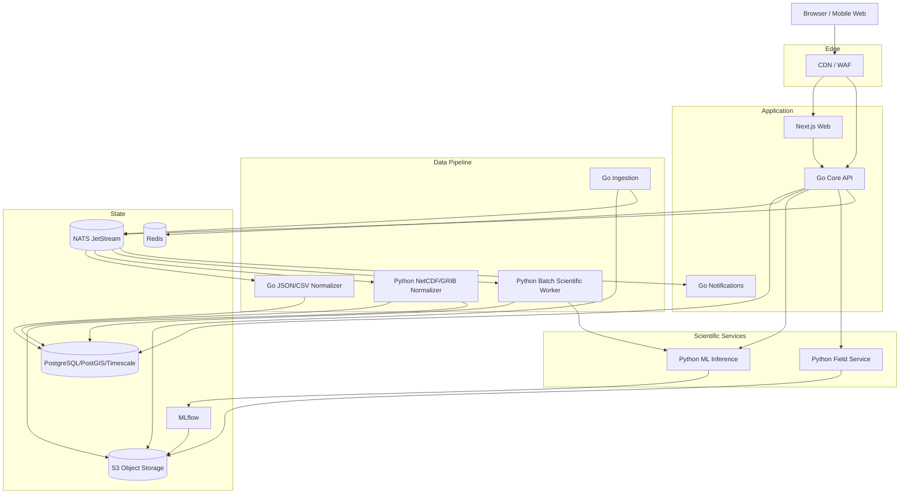
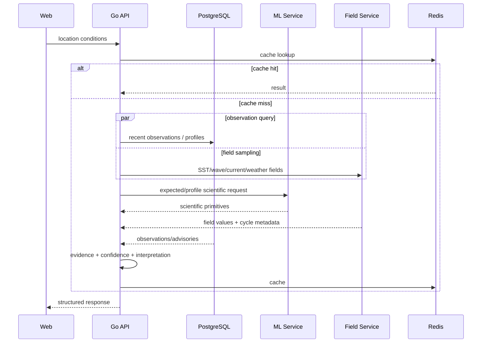
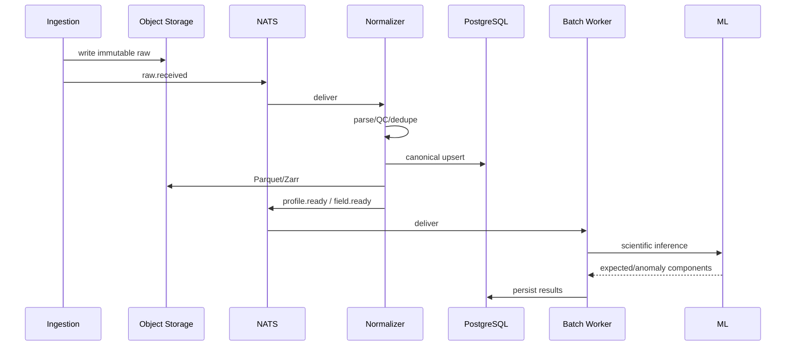

# Nautiq — System Architecture

> **Owns:** Services, technology stack, runtime communication, concurrency, storage ownership, reliability, security and deployment.  
> **Does not define:** scientific algorithms (`03`) or detailed data schemas (`02`).

---

## 1. Architectural goals

The system must handle:

1. heterogeneous external sources;
2. sparse profiles and dense gridded fields;
3. concurrent ingestion;
4. scientific reproducibility;
5. model/service failures without losing the core product;
6. fishing/trip decision support adjacent to life-safety;
7. a small development team.

The architecture should be **modular**, not unnecessarily distributed.

The diagram and stack below are target boundaries. Phase 0 is offline Python tooling. Phase 1 is a local Go API, web shell, lightweight scientific runtimes and storage. Observation delivery introduces one scheduler and one Python normalizer. Notifications, field serving and model registry are added with actual capabilities; Redis and NATS availability must not gate observation reads.

Start with stable service boundaries in one monorepo and deploy separately only where the runtime or scaling pattern justifies it.

---

## 2. Chosen stack

| Concern | Technology |
|---|---|
| Web | Next.js + TypeScript |
| Core application/API | Go |
| Scientific/ML | Python |
| Operational data | PostgreSQL + PostGIS + TimescaleDB |
| Object/lake storage | S3-compatible storage |
| Hot cache | Redis |
| Async event backbone | NATS JetStream |
| ML tracking/registry | MLflow |
| In-situ offline format | Parquet |
| Gridded fields | Zarr |
| Internal Go↔Python RPC | gRPC + Protocol Buffers |
| Observability | OpenTelemetry + Prometheus/Grafana-compatible stack |

---

## 3. Why Go is the core backend

Go owns the application/backend layer because Nautiq naturally has concurrent I/O:

```text
fetch observation data
fetch advisory state
fetch field samples
load watchlist
call ML
query database
```

Go gives:

- cheap goroutines;
- context cancellation;
- straightforward worker pools;
- strong networking support;
- low runtime overhead;
- easy static deployment;
- race detection tooling.

Python remains responsible for scientific formats and ML where its ecosystem is much stronger.

This is a deliberate split, not a competition between languages.

---

## 4. High-level architecture



---

## 5. Deployable responsibilities

### `web` — Next.js

Owns:

- public pages;
- authenticated UI;
- map/dashboard rendering;
- server-side web composition;
- session-facing web logic.

Does not own scientific calculations.

### `api` — Go Core API

Owns:

- external REST API;
- authentication/authorization;
- request validation;
- geospatial orchestration;
- watchlists/routes/activity profiles;
- trip-assessment rules;
- evidence/confidence composition;
- natural-language query-plan validation;
- caching;
- alert-rule management;
- export/report orchestration.

### `ingestion` — Go

Owns:

- provider schedules;
- discovery cursors;
- concurrent downloads;
- checksums;
- raw-artifact registration;
- `raw.received` events.

Does not parse scientific NetCDF content.

### `normalizer-go`

For simple JSON/CSV providers.

Owns:

- parse;
- unit mapping;
- canonicalization;
- idempotent writes.

### `normalizer-py`

For:

- NetCDF;
- GRIB;
- Xarray-based scientific datasets;
- Zarr creation.

### `ml-inference`

Owns only:

- reference/expected-state inference;
- calibrated intervals;
- residual/profile methods;
- model metadata.

Does not query user tables.

### `field-service`

Read-only service for Zarr fields.

Supports:

- sample point;
- sample route;
- polygon statistics;
- field/raster tiles;
- forecast cycle resolution.

### `batch-worker`

Runs expensive/repeatable scientific work off the request path:

- new-profile scoring;
- event detection;
- regional aggregates;
- map-grid scientific products;
- stale prediction recomputation.

### `notifications`

Owns:

- alert lifecycle;
- deduplication;
- delivery;
- retries;
- receipts.

---

## 6. Synchronous vs asynchronous communication

### Synchronous

Use REST externally.

Use gRPC internally for:

```text
Go API → ML inference
Go API → Field Service
batch worker → ML inference
```

Reasons:

- typed contracts;
- deadlines;
- generated clients;
- smaller ambiguous surface than ad-hoc JSON.

### Asynchronous

NATS JetStream for:

```text
raw.received
profile.ready
profile.revised
field.ready
advisory.updated
prediction.ready
event.detected
alert.evaluate
notify.send
```

Events are at-least-once.

Therefore every consumer must be idempotent.

---

## 7. Go concurrency design

### 7.1 Request fan-out

For a location/trip query, independent work can run concurrently.

Example:

```go
g.Go(func() error { return fetchObservations(ctx) })
g.Go(func() error { return fetchAdvisories(ctx) })
g.Go(func() error { return sampleForecastFields(ctx) })
g.Go(func() error { return getCachedScientificResult(ctx) })
```

Use `errgroup.WithContext` where failure should cancel sibling work.

### 7.2 Bounded provider downloads

Never launch one goroutine per remote file without a limit.

Use:

```text
discovery queue
→ semaphore / worker pool
→ provider fetch
```

Each provider has its own concurrency and rate limits.

### 7.3 Context cancellation

Every DB, HTTP and gRPC operation uses the request/job context.

If:

- client disconnects;
- deadline expires;
- parent job is cancelled;

downstream work should terminate.

### 7.4 Synchronization

Prefer:

- channels for pipelines;
- `errgroup` for task groups;
- mutexes only for small in-process state;
- PostgreSQL advisory locks for scheduled singleton ingestion;
- Redis only for non-critical ephemeral locking.

Correctness must not depend on a fragile distributed Redis lock.

---

## 8. Storage ownership

### PostgreSQL

Operational source of truth for:

- observations/profile catalog;
- predictions/results metadata;
- advisories;
- users;
- routes/watchlists;
- alerts;
- calculations.

### Object storage

Source of truth for:

- raw files;
- Parquet lake;
- Zarr fields;
- training snapshots;
- model artifacts;
- exports/reports.

### Redis

Only:

- query cache;
- hot map summaries;
- rate counters;
- short-lived session/cache state.

If Redis disappears, the system should become slower, not incorrect.

### NATS

Transport and retry state, not the permanent scientific source of truth.

---

## 9. Runtime flow: location conditions



---

## 10. Runtime flow: fishing/trip assessment

```text
route + time + activity
      ↓
advisories ─┐
forecast fields ─┼→ Go rules engine
freshness ───────┤
activity limits ─┘
      ↓
verdict + reasons + worst route segment
```

The ML service is not required for the verdict.

Ocean anomaly context may be attached separately.

---

## 11. Runtime flow: new scientific data



---

## 12. Graceful degradation

The platform should remain useful when optional systems fail.

Preferred ladder:

1. observations + expected/anomaly + fields + advisories;
2. observations + climatology + fields + advisories if ML fails;
3. observations + expected/anomaly + advisories if field service fails;
4. observations + advisories;
5. observations only.

For trip assessment:

- stale/unknown advisory feed → cannot return `favorable`;
- missing critical forecast field → `insufficient_data`;
- ML failure does not affect trip verdict.

---

## 13. Failure handling

| Dependency | Failure behavior |
|---|---|
| one source | mark that layer delayed; other sources continue |
| ML | climatology fallback or “prediction unavailable” |
| Field Service | no field layer; trip result becomes insufficient if fields are critical |
| advisory source | explicit “advisory status unknown” |
| Redis | bypass cache |
| NATS | ingestion raw files remain durable; processing resumes later |
| PostgreSQL write outage | read-only/degraded mode where possible |
| bad model/data release | kill switch + rollback |

Scientific wrongness is an incident even if HTTP uptime is perfect.

Recovery details are normative in Sections 19–23 and `08-Execution-Contracts.md`.

---

## 14. Security boundaries

### Public

- CDN/WAF;
- Next.js;
- public REST endpoints.

### Private application network

- ML service;
- Field Service;
- NATS;
- PostgreSQL;
- Redis;
- MLflow;
- object storage endpoints.

Requirements:

- TLS;
- service-to-service private network/mTLS where appropriate;
- secrets outside Git;
- DB not internet-accessible;
- object storage private by default;
- parameterized SQL;
- outbound provider allowlists;
- request/payload timeouts.

---

## 15. Observability

Use OpenTelemetry across Go, Python and web.

Track:

```text
request latency/error rate
DB latency
cache hit ratio
gRPC latency
NATS consumer lag
provider fetch latency/failure
ingestion freshness
QC rejection rate
field cycle freshness
ML inference latency
scientific fallback rate
alert delivery status
```

Every user-visible calculation should carry a `calculation_id`/traceable evidence identifier.

---

## 16. Local development

Docker Compose should start:

This is the eventual local stack. Phase 1 omits MLflow, loaded model bundles and scientific fixtures until needed; see `07-Phase-1-Delivery.md` for measured delivery. Phase 0 runs independently without containers.

```text
Next.js
Go Core API
Python ML service
Python Field Service
PostgreSQL + PostGIS + TimescaleDB
Redis
NATS JetStream
MinIO
MLflow
```

Seed data must be small enough to run locally.

Provide:

- fixture profiles;
- one small gridded Zarr product;
- stub advisory feed;
- test model/climatology bundle.

The entire UI should render offline from fixtures.

---

## 17. Deployment strategy

### Early production

Prefer managed infrastructure with minimal operational burden.

Possible shape:

- managed PostgreSQL;
- managed Redis;
- S3/object storage;
- container hosting for API/services/workers;
- managed monitoring.

### Scale target

Kubernetes becomes useful when:

- worker concurrency is high;
- multiple services need independent scaling;
- autoscaling based on queue lag is valuable;
- operational maturity justifies it.

Do not begin by building Kubernetes complexity if usage does not require it.

### Target production topology

```text
CDN/WAF
  ├─ Next.js
  └─ Go API
       ├─ PostgreSQL
       ├─ Redis
       ├─ ML gRPC
       ├─ Field Service gRPC
       └─ NATS
            ├─ ingestion/normalization workers
            ├─ batch scientific workers
            └─ notifications

Object storage backs raw/Parquet/Zarr/models.
```

---

## 18. Architecture invariants

These should remain true even if individual technologies change:

1. raw scientific input is immutable;
2. in-situ and gridded data have different storage paths;
3. Go owns user-facing orchestration and deterministic decision rules;
4. Python owns scientific/ML-heavy processing;
5. ML failure cannot remove raw observation access;
6. official advisory state is separate from model signals;
7. events are at-least-once, so consumers are idempotent;
8. every scientific result is versioned and reproducible;
9. geography is configuration/data, not hard-coded business logic;
10. service boundaries can be deployed together initially without changing ownership.

## 19. Crash-safe ingestion and event delivery

The diagram's DB/object/event writes are not atomic. Use a transactional outbox in PostgreSQL and a consumer inbox. `migrations/002_reliability.sql` supplies foundational tables; dispatchers and source consumers are Phase 2 work, not claimed complete in Phase 1.

An outbox envelope has event ID, event type, schema version, aggregate key, raw/revision digest, created time and bounded payload. Transport events contain artifact identifiers, not entire scientific files or arbitrary remote fetch URLs. Insert domain state and event in one transaction. A dispatcher claims rows using a bounded lease with `FOR UPDATE SKIP LOCKED`, publishes with a stable message ID, waits for JetStream acknowledgement, then records publication. Lost acknowledgement may publish twice; uniqueness and inbox transactions handle it. Never mark published before broker acknowledgement.

Consumers validate envelope/version, check artifact hash, write inbox receipt and scientific/domain updates plus downstream outbox atomically, then acknowledge. A duplicate delivery is a committed no-op. Retryable transient failures use backoff and a bounded retry budget. Poison/unsupported events enter a durable quarantine/dead-letter registry with reason and artifact ID; alert and retain a replay path. Duplicate, late and out-of-order events must converge to the newest authorized revision.

Broker deduplication is an optimization, not the correctness boundary. Retention must exceed maximum outage/replay horizon; size/age limits and queue-lag alerts prevent silent event loss. PostgreSQL/raw manifests can reconstruct pending work if transport retention expires. Reconcile object orphans, stale leases, missing manifests and events at startup and periodically. A burst backfill must not starve current ingestion: separate quotas/queues and bounded workers.

## 20. Health, readiness and capabilities

- `/health/live`: process responsiveness; no external dependencies.
- `/health/ready`: required PostgreSQL, PostGIS, Timescale and exact schema checks for this platform; optional Redis, NATS, scientific runtimes and web are excluded.
- `/api/v1/health`: diagnostic dependency report; returns 503 if any monitored dependency fails. This endpoint is not the load balancer readiness probe.
- `/api/v1/capabilities`: explicit implemented product capabilities. Phase 1 declares scientific/observation/trip capabilities false. Scientific gRPC `Check` reports runtime readiness separately from loaded capability flags.

Do not make API traffic readiness depend on the web frontend: that creates a circular deployment gate. Background-worker readiness additionally depends on its own broker/storage requirements; endpoint-specific capability checks control scientific/trip operations. A runtime health response never establishes source freshness, model release approval or advisory completeness. Shared health checks use deadlines, concurrency limits and sanitized errors; public production status shows aggregates rather than internal hostnames.

## 21. Schema, cache and calculation consistency

`scripts/migrate.py` applies ordered migrations under a transaction-scoped advisory lock, checks stored SHA-256 and rejects changed/applied migrations or a newer DB. `make up` runs it before API startup. Existing v1 volumes are adopted only after capability/version checks; original legacy initialization had no checksum, so adoption cannot prove historical SQL byte identity. Subsequent edits require a new migration. Rollback is an application/schema compatibility plan, never automatic volume deletion. Large production changes use expand/backfill/contract and bounded lock timeouts rather than one long DDL transaction.

Cache keys include source revision/cycle/valid time, geography/depth, QC/schema, method release, threshold version and authorization scope. TTL is capped by source validity; warning updates invalidate intersecting cached verdicts. Unknown advisory state cannot reuse a cached favorable verdict. Stampede control uses bounded singleflight and stale observation-only reads, never stale favorable assessments. Redis failure bypasses cache and applies request limits; the DB remains the source of truth.

Each calculation stores a pinned input manifest and policy/release digests, evaluation time and valid window. Reproducibility distinguishes original as-of evidence from a recalculation with revised inputs. Returning a calculation ID is meaningful only if its evidence exists durably; avoid an identifier pointing at transient memory. Large exports stream a snapshot or background artifact, with pagination/resource limits and license policy.

## 22. Service isolation and resource budgets

Use explicit per-provider limits, bounded decompression and array dimensions, maximum object/request size, query bounds and cancellable deadlines. Untrusted NetCDF/GRIB parsing runs in restricted workers with memory/CPU quotas and read-only scientific input; parser failure cannot crash Core API. Model bundles are checksummed trusted build artifacts; do not accept user-supplied pickle/joblib models. Production egress validates allowed HTTPS origin and resolved IP at connection time, including redirects; cloud metadata/private destinations are prohibited. The local feasibility probe denies redirects and checks a catalog allowlist; it is not a general remote URL service.

Request fan-out separates optional and mandatory work. An optional ML failure must not cancel observations/advisories through a shared fail-fast group. Propagate deadlines; preserve partial structured results and layer-specific errors. Separate online serving and backfill/training pools. gRPC messages/concurrency are bounded; scientific serving warms a pinned release atomically and never replaces a bundle halfway through a request.

Local credentials and plaintext Compose RPC are development-only. Production requires scoped DB/object/broker identities, private networking/TLS, trusted forwarded headers, CSRF/session controls and per-user object authorization. Exports, routes and alerts require ownership checks, quotas and retention/deletion rules before exposure. Provider failures and scientific incidents have kill switches independent of deployment health.

## 23. Operational gates

Capacity plans publish ingest bytes/day, rows/profiles/day, worker lag, DB/object retention, route sample ceilings and query latency budgets. Initial operational budgets are in `08`; benchmark them before production rather than promising unsupported throughput. Pin dependency locks and release image digests in production. Backups include DB, immutable object manifests and release bundles; test a coordinated restore and recomputation, not just file existence. Restore/integrity incidents block favorable verdicts until freshness/advisory state is reestablished.

## Implemented predictive interval evidence

The diagnostic quantile/CQR workflow, exact parent pins, profile aggregation unit, hierarchical fallback, revision/selection/lease checks and fixed-reference coverage monitor are delivered in [the uncertainty implementation report](15-Phase-6-Delivery.md). Its current measurements are in [the evidence snapshot](evidence/phase6-summary.json). `predictive_intervals` records supported implementation availability; `calibrated_uncertainty` requires empirical coverage and independent review gates. The already inspected historical test cannot establish untouched-test approval. Mean and median remain separate; no automatic recalibration or anomaly verdict is introduced.

## Implemented independent Field Service

The Go API now calls a separate typed read-only field runtime for point/route/polygon samples and PNG tiles. Four bounded provider adapters stage immutable Zarr objects before transactional SQL/calculation/outbox publication; the existing dispatcher routes `field.ready` to a separate JetStream stream. Serving hash-checks metadata and requested chunks, pins one release per query, limits concurrency/messages/cache/work, and sanitizes dependency failures. Field failure does not disable observation reads or change profile-model pins. An optional `fields-live` worker runs acquisition separately from serving; it is excluded from default Compose startup. Production image builds use locked scientific dependencies, a nonroot process, read-only filesystem and resource limits. Exact budgets, replay/recovery commands and local evidence are in [field delivery](17-Phase-8-Delivery.md). API traffic readiness requires schema 10; field freshness and scientific approval remain endpoint/capability concerns.

## Implemented event workflow

The optional Python event-worker performs bounded archived acquisition, fixed-baseline fitting and immutable diagnostics using the shared package. Go serves bounded catalogs and checksum-verified details without performing scientific fitting. Schema 11 records content identities, profile snapshot lineage and indexed geometry; regional.event.ready is published through the existing transactional outbox into its own JetStream retention stream. Server-rendered event pages show exact inputs, persistence, geometry, coverage and explicit stale snapshots. There is no live event scheduler or notification service implied by a retained historical run. See [event delivery](18-Phase-9-Delivery.md) and its [measured evidence](evidence/phase9-summary.json).

The independent official advisory adapter is `ml/nautiq_ml/advisories/`, built as `ml/Advisories.Dockerfile`. It publishes schema-12 frozen CAP runs/revisions/calculations plus `advisory.feed.checked` through the durable outbox and `OFFICIAL_ADVISORIES` JetStream stream. The Core API verifies retained documents and computes advisory state in Go; the `/advisories` web surface exposes source health and agency evidence. No ML output interprets or replaces an official warning. See [advisory delivery](19-Phase-10-Delivery.md).
