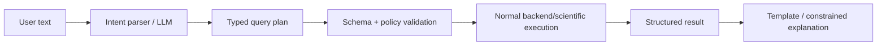

# Nautiq — Product Surfaces and API

> **Owns:** What users see and how they interact with the platform: screens, maps, routes, alerts, natural-language query flow and public API contracts.  
> **Scientific methods live in `03`; backend/deployment internals live in `04`.**

---

## 1. Information architecture

### Public

```text
/
/map
/locations/[slug]
/regions/[slug]
/insights
/methodology
/data-sources
/models
/status
```

### Signed-in

```text
/app
/app/map
/app/watchlists
/app/routes
/app/alerts
/app/explorer
/app/reports
/app/exports
/app/settings
```

The product should not hide the useful experience behind an account. Authentication is mainly required for saved state, alerts and exports.

---

## 2. Ocean map

The map is the main exploration surface.

### Layers

- Argo/latest profiles;
- buoy/station observations;
- satellite SST;
- SST anomaly;
- expected-state deviation;
- profile anomaly markers;
- regional event polygons;
- currents;
- waves/swell;
- wind;
- advisory polygons;
- source coverage/freshness.

### Controls

```text
time
depth/depth range
variable
source
forecast valid time
anomaly/event layer
freshness
```

### Rendering

Use:

- raster tiles for dense continuous fields;
- vector tiles for observations/events;
- direct markers only for small result sets.

Do not push millions of raw points to the browser.

---

## 3. Location / region page

A location page answers:

> What is happening here right now, and how unusual is it?

Example:

```text
Mumbai Offshore

Latest observed SST       29.1 °C
Expected normal           27.4 °C
Expected interval         26.6–28.2 °C
Deviation                 +1.7 °C
Profile unusualness       97th percentile
Wave height               1.3 m
Surface current           moderate
Official advisory         none in current feed
Observation age           6 h
Forecast cycle age        1 h
Evidence confidence       High
```

Sections:

1. current conditions;
2. expected vs observed;
3. recent trend;
4. vertical profile;
5. field forecast timeline;
6. official advisories;
7. evidence/provenance;
8. nearby instruments.

---

## 4. Profile explorer

For a profile, plot:

```text
depth
vs
temperature / salinity
```

Overlays:

- observed;
- expected;
- lower/upper expected interval;
- residual;
- historical climatology.

Additional panels:

- strongest residual depth;
- residual-profile score;
- FPCA structural explanation;
- QC summary;
- platform/source;
- profile revision/data mode.

Research users can reveal exact numeric details; ordinary users see a simpler summary.

---

## 5. Fishing/trip assessment surface

Inputs:

```text
activity type
start location
optional route / destination
departure time
return time
optional personal thresholds
```

Output:

```text
Conditions: Caution

Main reasons
- waves increase after 15:00
- wind gusts reach the caution band
- current remains moderate
- advisory feed is healthy; no intersecting official warning

Best available window
06:00–11:00

Worst route segment
Waypoint 3 → Waypoint 4

Data freshness
wave forecast: 58 min
wind forecast: 42 min
advisories: 7 min
ocean observations: 6 h
```

The verdict is generated by deterministic rules.

---

## 6. Route view

User creates:

```text
departure
waypoints
destination
departure time
expected return
```

Nautiq samples forecast fields along route/time.

Display:

- route on map;
- color-coded segments;
- maximum wave height;
- maximum wind/gust;
- strongest current;
- low-visibility sections;
- advisory intersections;
- deterioration timeline.

Clicking a segment opens evidence.

---

## 7. Activity profiles

Optional saved preferences:

```text
activity
vessel class / size
preferred max wave height
preferred max wind/gust
preferred trip distance
home location/port
```

These are **user preferences**, not universal safety limits.

The UI must distinguish:

```text
official limit/advisory
vs
Nautiq default threshold
vs
your saved preference
```

---

## 8. Watchlists

A watchlist can be:

- coordinate/radius;
- named place;
- polygon;
- route;
- coastal/fishing region.

Watchlists power:

- dashboard;
- alerts;
- summaries;
- quick comparisons.

---

## 9. Alerts

Alert types:

### Scientific

- observed value outside calibrated expected interval;
- strong profile anomaly;
- regional warm event starts/strengthens/ends;
- rapid environmental change.

### Trip/environment

- wave/wind/current threshold;
- forecast deterioration;
- official advisory appears or changes;
- critical data feed becomes stale.

### Alert lifecycle

```text
new
→ active
→ escalated/updated
→ recovered
```

Deduplicate repeated notifications.

An alert stores the evidence snapshot that triggered it.

---

## 10. Natural-language search

Examples:

```text
"Is it a good time to go fishing near Goa tomorrow morning?"
"Why is Nautiq showing caution?"
"Show unusual profiles in the Arabian Sea this week."
"Compare salinity near Kerala with normal October conditions."
"When will waves be lowest on my route?"
"Is there an official warning near my destination?"
```

### Correct flow



The language model cannot directly invent:

- observations;
- forecasts;
- advisory status;
- ML values;
- safety verdict.

It may paraphrase a structured result after validation.

---

## 11. Evidence panel

Every scientific/decision result has a “How was this calculated?” drawer.

Examples below are illustrative values, not measurements or enabled product behavior. Argo evidence includes actual location, sampling depth and query distance; it cannot substantiate a surface value at a different coordinate without a validated collocation method.

Example:

```text
Question
Is the ocean warmer than normal here?

Observation
29.1 °C
source: Argo GDAC
observed: 12:40 UTC
QC: accepted

Reference
harmonic climatology v4
baseline: 2005–2024

ML correction
LightGBM residual model v7

Expected
27.4 °C
80% calibrated interval: 26.6–28.2 °C

Difference
+1.7 °C

Profile structure
residual percentile: 97.6
FPCA structural percentile: 95.2

Calculation
calc_...
```

For trip assessment, show:

- forecast product/cycle;
- sampled route points;
- advisory version;
- threshold set;
- stale/missing inputs;
- rules that fired.

---

## 12. Confidence display

Confidence is not a model probability unless it truly is one.

Evidence confidence can consider:

These are inputs to a future versioned policy, not permission to invent a colored score. Until that policy is validated, show factual coverage/freshness/availability labels rather than `High`. Confidence must be per layer; independent-source counts cannot include duplicated profiles or assimilated copies of the same observations.

```text
freshness
coverage
number of observations
independent sources
validated model domain
interval width
field availability
source agreement
```

Labels:

```text
High
Moderate
Limited
Insufficient
```

If `Insufficient`, do not hide it behind a colored score.

---

## 13. Research explorer

Capabilities:

- bounding-box/polygon query;
- date/time range;
- depth range;
- source;
- variable;
- QC state;
- profile anomaly percentile;
- event membership.

Views:

- map;
- table;
- profile chart;
- time series;
- expected-vs-observed;
- residual depth heatmap.

Export:

- CSV;
- Parquet;
- NetCDF where scientifically appropriate and licensing permits.

---

## 14. Comparison mode

Compare:

```text
location A vs B
region A vs B
current vs historical period
observed vs expected
two seasons
two depth ranges
```

Always align units/time windows before comparing.

Display data-coverage differences so sparse data is not mistaken for a real difference.

---

## 15. Reports and summaries

Reports:

- location summary;
- route/trip report;
- weekly watchlist summary;
- regional anomaly/event report;
- research result report.

Every report includes:

```text
generated_at
valid data times
source list
calculation IDs
model/method versions
important limitations
```

---

## 16. Core REST API

Base:

```text
/api/v1
```

### Conditions

```http
GET /conditions/point
GET /conditions/region/{region_id}
```

### Observations / profiles

```http
GET /observations
GET /profiles
GET /profiles/{id}
```

### Scientific result

```http
GET /expected/point
GET /anomalies/profiles
GET /events
```

### Fields

```http
GET /fields/sample
GET /fields/route
GET /map/tiles/{layer}/{z}/{x}/{y}
```

### Trip assessment

```http
POST /trip-assessments
GET  /trip-assessments/{id}
```

### Watchlists / routes / alerts

```http
GET|POST /watchlists
GET|POST /routes
GET|POST /alert-rules
GET      /alerts
POST     /alerts/{id}/acknowledge
```

### Query interface

```http
POST /query
```

### Export/report

```http
POST /exports
GET  /exports/{id}
POST /reports
GET  /reports/{id}
```

---

## 17. Example conditions response

This is a sketch of the final product, not a complete contract. Before implementation use the normative profile contract in `packages/schemas/profiles.openapi.json` and `08-Execution-Contracts.md`. The final conditions schema must include actual observation coordinates, query distance, variable/depth, source revision, receive time, separate forecast cycle/valid time and per-layer freshness/availability; the single `freshness_seconds` field below is insufficient for a multi-source answer.

```json
{
  "location": {
    "lat": 19.0,
    "lon": 72.6,
    "label": "Mumbai Offshore"
  },
  "observation": {
    "temperature_c": 29.1,
    "observed_at": "2026-10-01T10:40:00Z",
    "source": "argo_gdac",
    "quality": "accepted"
  },
  "expected": {
    "median_c": 27.4,
    "lower_c": 26.6,
    "upper_c": 28.2,
    "residual_c": 1.7,
    "method_release": "..."
  },
  "profile": {
    "residual_percentile": 97.6,
    "fpca_percentile": 95.2,
    "dominant_depth_band": "20-80m"
  },
  "evidence": {
    "confidence": "high",
    "calculation_id": "calc_...",
    "freshness_seconds": 21600
  }
}
```

---

## 18. Example trip response

```json
{
  "verdict": "caution",
  "activity": "small_boat_fishing",
  "window": {
    "start": "...",
    "end": "..."
  },
  "reasons": [
    {
      "variable": "significant_wave_height",
      "status": "deteriorating",
      "max_value": 2.2,
      "unit": "m"
    }
  ],
  "best_window": {
    "start": "...",
    "end": "..."
  },
  "advisory_status": "known_none_intersecting",
  "input_freshness": {},
  "calculation_id": "calc_..."
}
```

---

## 19. Product language rules

Consumer copy should favor:

```text
warmer than expected
strong deviation
unusual profile
conditions call for caution
official advisory active
data is limited/stale
```

Avoid exposing raw scientific jargon unless expanded.

Research mode can show:

```text
residual
calibrated interval
FPCA reconstruction error
comparison group
method release
QC flag
```

---

## 20. Mobile/accessibility requirements

- responsive map and condition cards;
- keyboard-accessible alternatives to map-only information;
- no severity encoded only by color;
- screen-reader labels;
- unit text alongside values;
- reduced-motion support;
- safety/advisory messages readable without opening a map;
- saved last-viewed conditions for weak connectivity where practical.

The mobile priority is:

```text
search
→ conditions
→ trip assessment
→ alerts
→ evidence
```

## 21. Normative query and matching behavior

Profile API v1 returns a canonical current revision by default, with explicit revision retrieval where supported. Lists use bounded cursor pagination and deterministic `(observed_at, profile_id)` order pinned to an as-of snapshot; concurrent revisions cannot make pages duplicate/skip records. Empty lists return 200 with zero items. Unsupported parameters, invalid geometry, excessive query volume and malformed times produce typed errors, not silent broad queries.

All timestamps are UTC RFC3339 with offset; local display uses the user's zone. Relative questions (“tomorrow morning”) require resolved zone and explicit interval before scientific execution. Latitude/longitude ranges, dateline-crossing boxes, invalid polygons, coast/land masks and route limits are validated. A point query separates requested point from source position/depth/time; no undeclared nearest-profile extrapolation. No Argo SST label unless the instrument's depth and method justify it.

Methods/units/estimands are explicit: residual-boosted mean differs from q50 median; observed-minus-reference residual is separate from ML correction. Missing numeric values are null with reason codes, never NaN/Infinity/zero. Every layer has `available`, `stale`, `outside_domain`, `outside_horizon`, `unknown`, or `unavailable` plus valid/received times. Field cycle metadata is not inferred from request time.

## 22. Trip verdict and route edge behavior

The versioned precedence table and required inputs are in `08`. Relevant known official warning takes precedence even if another feed is unknown. Otherwise missing/unknown critical data takes precedence over a favorable assessment. Preserve all fired rules and insufficiencies even when a single primary verdict is selected. User thresholds can make a verdict stricter but cannot remove an official warning or bypass required inputs; label preference origin and avoid treating vessel size as a validated capability.

A route requires timed waypoints or a supplied reviewed travel-time model. Departure/return alone does not identify arrival time at each segment. Include outward/return legs and stops. Sampling spacing and time steps are bounded and recorded; reject requests exceeding budget rather than silently coarsening away extremes. No samples across land/masked cells, outside product domain or beyond horizon. Forecast uncertainty, tides/local hazards and unresolved advisory geometry remain limitations; the engine never claims navigation-grade safety.

Best window optimization requires a completely evaluated contiguous interval long enough for the trip, not the single calmest hour. Unknown gaps break candidate windows. Equality at a threshold is defined in the policy; warning updates and deteriorating forecasts invalidate saved favorable results.

## 23. Authenticated state, exports and alerts

Authentication and authorization ship before saved routes/watchlists/alerts/exports. Never accept a user ID from the client as proof of ownership. Idempotency keys protect POST retries and notification delivery; optimistic version checks prevent lost edits. Alert deduplication includes rule version, event/revision and recipient; evidence snapshots are immutable. Recovery requires positive fresh evidence, not a failed fetch or vanished upstream item. Revised/retracted scientific results trigger a correction workflow, not erasure of delivered evidence.

Rate-limit expensive queries and exports, bound polygons/date ranges, paginate tables, and cancel abandoned jobs. Protect CSV formula injection, enforce source redistribution permissions and expire private download links. Session expiry while editing retains a local draft without exposing another user's route; public map tiles contain no saved user data. Notification opt-out applies before delivery attempts and retries.

## 24. Usability under degraded connectivity

Keep map-independent tables and status explanations keyboard/screen-reader accessible. Severity uses text/icons as well as color; unknown is visibly distinct from favorable. Cancel superseded map/search requests and reject out-of-order responses using query IDs. Render loading, empty, expired and partial states separately. Cache eviction or a disconnected client cannot convert absent values into healthy status. Offline saved trip evidence is labelled historical and must never be automatically renewed.

## Implemented predictive interval evidence

The diagnostic quantile/CQR workflow, exact parent pins, profile aggregation unit, hierarchical fallback, revision/selection/lease checks and fixed-reference coverage monitor are delivered in [the uncertainty implementation report](15-Phase-6-Delivery.md). Its current measurements are in [the evidence snapshot](evidence/phase6-summary.json). `predictive_intervals` records supported implementation availability; `calibrated_uncertainty` requires empirical coverage and independent review gates. The already inspected historical test cannot establish untouched-test approval. Mean and median remain separate; no automatic recalibration or anomaly verdict is introduced.

## Implemented field explorer

The `/fields` catalog and exact-release pages show SST, waves, wind/weather and surface currents. Provider initialization, valid time, normalized publication time, source revision, selection, freshness and hashes remain distinct. Native raster tiles preserve coastal masks; pan/zoom, variable/time controls and map clicks have a coordinate-form alternative. Timed route editing includes stops and return legs, exposes every sample and clears superseded results on input changes. Scrollable evidence tables retain keyboard access. Point, route, polygon and tile contracts are in `packages/schemas/fields.openapi.json`; [field delivery](17-Phase-8-Delivery.md) records live and browser checks. Routes are ephemeral inspection requests; authenticated saved state, event interpretation, advisories and trip verdicts remain future capabilities.

## Implemented event explorer

The /events catalog links detection runs, fixed baselines, exact source datasets and durable calculations. Run maps show native SST cell footprints or observed profile points, with accessible support/coverage tables. Component pages distinguish persistent SST candidates, regional profile point groups and isolated evidence; they disclose intensity units, dates, persistence, actual support and censoring. Historical/frozen and current/stale profile snapshot states are visible. Empty detection output and missing evidence are separate states; neither certifies event absence. See [event delivery](18-Phase-9-Delivery.md) and its [measured evidence](evidence/phase9-summary.json).

The `/advisories` catalog and exact-revision pages expose original agency CAP messages, all languages, effective/onset/expiry, references, original source links and byte hashes. Source transport freshness, integrity and marine coverage are separate. A location/window form shows relevant official warnings or explicit unknown conditions; empty or stale feeds never become an all-clear. Valid CAP polygons form an inspection layer with a keyboard table; text-only areas remain unmapped. See [advisory delivery](19-Phase-10-Delivery.md).

The `/trips` surface edits timed outward/return routes and stops, pins forecast releases, exposes useful grouped missing conditions, worst retained samples and source cycles, and inspects/replays private frozen receipts. Controls clear superseded results on changes and retain keyboard access to wide tables. No travel time or vessel capability is inferred. Current numeric policy is unapproved, so real trips remain insufficient data unless a relevant known official warning has priority. No favorable or navigation-grade safety claim is implied. See [trip delivery](20-Phase-11-Delivery.md).

## Delivered alert monitoring

[Alerts delivery](22-Phase-13-Delivery.md) implements owned enabled rules, per-rule/worker health, in-app evidence, verified-recipient email settings and delivery status. Empty inboxes are not an all-clear; unknown inputs preserve active alerts. Recovery/correction wording retains the difference between personal preference, authority references and approved safety advice. Email verification does not provide login recovery. Public production and scientific release gates remain independent.

## Implemented guided entry, question answering and model summaries

The home page, `/start`, grouped navigation and footer implement the first-use path in section 1 and the mobile priority in section 20 (search → conditions → trip → alerts → evidence). `/ask` implements section 10: a question becomes a validated query frame with an explicit, correctable UTC window, executes through typed backend evidence, and is answered with fixed templates; the language model, if configured, only labels the question. Location pages open with a plain-language conditions summary built the same way. Trip questions hand off to the timed-route form and never receive a verdict. Model output appears as a plain-language brief with its limits, and profile pages show a combined evidence category with its components. Details and limits: [27-Product-Completion-Delivery.md](27-Product-Completion-Delivery.md).
